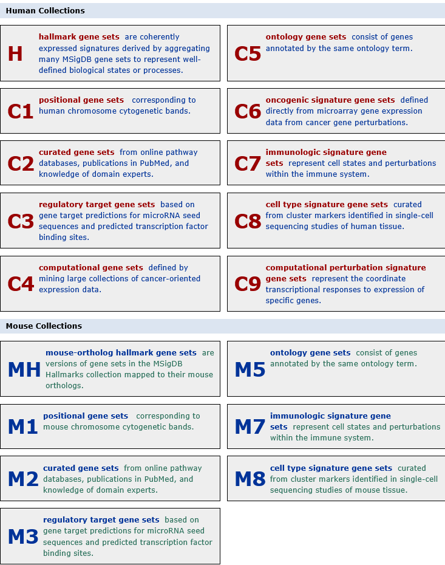

<!-- ADDITIONAL CODES / HACKS -->

<!-- CSS code to center the QMD title -->

```{=html}
<style>
#title-block-header .title {
  text-align: center;
}
</style>
```

<!-- CSS code to center the imported images -->

```{=html}
<style>
.center-image {
  display: block;
  margin-left: auto;
  margin-right: auto;
}
</style>
```

<!-- CSS code to displace the clipboard copy button slightly to the left so that it does not overlap code annotations -->

```{=html}
<style>
.code-with-filename .code-copy-button {
  right: 2.5rem !important;
}
</style>
```

<!-- HTML code to force table borders -->

```{=html}
<style>
td, th {
  border: 1px solid black;
  border-collapse: collapse;
}
</style>
```

<!-- BODY -->

<br>

------------------------------------------------------------------------

------------------------------------------------------------------------

{.center-image}

------------------------------------------------------------------------

------------------------------------------------------------------------

# Purpose of this session {#purpose-of-this-session}

This file describes the different steps to perform **differential expression analyses** of the **single cell RNAseq** data analysis training course for the **EB3I n1 2026**, covering these steps :

- Prepare your gene list for enrichment analyses
- Download a biological knowledge database
- Run enrichment analyses

**Input data**: the Seurat object with annotations. `12_TD3A_TDCT_S5_Integrated_Annotated_12926.7709.RDS`

**Output data**: saved in your `RESULTS` directory:

| File | Content |
|:------------------------------------|:----------------------------------|
| `ORA_results.RDS` & `ORA_results.tsv` | Results of ORA |
| `GSEA_results.RDS` & `GSEA_results.tsv` | Results of GSEA |

------------------------------------------------------------------------

------------------------------------------------------------------------

# What to run ? {#what-to-run}

You are **not intended** to run all of the chunks. We use a **color code**:

| What you see | What it means |
|:-----------------------------------|:-----------------------------------|
| A regular code chunk | **Run it** |
| A [**lightblue**]{style="color:lightblue"} "QUESTION" callout | Think about it before unfolding the answer |
| A [**lightgreen**]{style="color:lightgreen"} "ANSWER" callout | Folded by default |
| A [**yellow**]{style="color:yellow"} / [**orange**]{style="color:orange"} "OPTIONAL" callout | Extra content if you are ahead, not supported during the session |
| A [**pink**]{style="color:pink"} "DEMO" callout | Shown by the teacher, **do not run** |

<br>

------------------------------------------------------------------------

------------------------------------------------------------------------

# Start RStudio

Using the [OpenOnDemand/Rstudio cheat sheet](https://moodle.france-bioinformatique.fr/pluginfile.php/1475/mod_folder/content/0/OoD_R_Rstudio.html), connect to the [OpenOnDemand portal](https://ondemand.cluster.france-bioinformatique.fr/) and create a Rstudio session with the right resource requirements, thanks to the cheat sheet.

------------------------------------------------------------------------

------------------------------------------------------------------------

# Warm-up

## Load the packages

```{r, message=FALSE}
#| label: load_libraries
#| filename: load_libraries

library(Seurat)
library(msigdbr)
library(clusterProfiler)
library(AUCell)
library(ggplot2)
library(dplyr)
```

## Common parameters

```{r}
#| label: set_param
#| filename: set_param

## Seed for the random number generator
my_seed <- 1337L

## A common look for all the figures of this session
theme_set(theme_minimal(base_size = 13))

```

## Directories and input data

::: callout-warning
`ebaii_sc_teachers` is a project created by and for us, teachers.

Thus, **DO NOT** just copy-paste this `ebaii_sc_teachers` project name as-is, put **YOURS** !
:::

```{r}
#| label: fs_set_pjname
#| filename: fs_set_pjname

## Set your project name
project_name <- "ebaii_sc_teachers"

## Check that it exists
file.exists(paste0("/shared/projects/", project_name))

```

::: callout-important
If this chunk returned `FALSE`, you may have misspelled your project name !
:::

We build the directories of this session in one go (they were explained in Preprocessing 1):

```{r}
#| label: fs_set_dirs
#| filename: fs_set_dirs
#| message: true

## Main training directory
TD_dir <- paste0("/shared/projects/", project_name, "/SC_TD")

## Current session (Enrichment) directory, with its input and output sub-directories
session_dir <- paste0(TD_dir, "/09_Enrichment")
input_dir <- paste0(session_dir, "/DATA")
output_dir <- paste0(session_dir, "/RESULTS")
dir.create(path = input_dir, recursive = TRUE)
dir.create(path = output_dir, recursive = TRUE)

message('Directory [', session_dir, '] created.')

```

We load the functions that fetch the input data:

```{r}
#| label: fetch_src
#| filename: fetch_src
#| attr.output: '.details summary="Show output"'

source(
  file = "/shared/projects/2621_eb3in1_2026/atelier_scrnaseq/SOURCES/fetch_functions.R",
  echo = TRUE
)

## Folder of the backup of all intermediate Seurat objects
backup_dir <- "/shared/projects/2621_eb3in1_2026/atelier_scrnaseq/DATA_BACKUP/INTERMEDIATE"

```

We load the Seurat object saved at the end of the previous session. If you do not have it (error, lost file...), a copy is fetched from the backup:

```{r}
#| label: data_load
#| filename: data_load

## The DEA table saved at the end of 07_DEA
dea_file <- "12_TDCT_TD3A_S5_DEA_allMarkers.csv"
dea_path <- paste0(TD_dir, "/07_DEA/RESULTS/", dea_file)  # <1>

## If it does not exist, copy it from the backup
if (!file.exists(dea_path)) {
  dea_path <- backup_get_data(
    backup_file = paste0(backup_dir, "/", dea_file),  # <2>
    local_path = input_dir)
}

## Load the object
dea_table <- read.csv(file = dea_path, row.names = 1)
head(dea_table)
```

1.  Where your own seurat object is
2.  The backup copy, copied into your `DATA` directory

We also prepare a small function to save the objects of this session with the naming convention of the course (step number, sample, step name, object dimension):

```{r}
#| label: save_func
#| filename: save_func

save_step <- function(object, step_number, step_name) {
  out_name <- paste0(
    output_dir, "/",
    paste(
      c(step_number, Seurat::Project(object), "S5", step_name,
        paste(dim(object), collapse = ".")),
      collapse = "_"),
    ".RDS")
  saveRDS(object = object, file = out_name)
  message("Saved [", out_name, "]")
}

save_enrichment <- function(object, enrich_test, comp) {
  out_rds <- paste0(
    output_dir, "/",
    paste(enrich_test, comp, nrow(object), sep = "_"),
    ".RDS")
  out_tsv <- gsub(".RDS", ".tsv", out_rds)
  saveRDS(object = object, file = out_rds)
  write.table(data.frame(object), out_tsv, row.names = FALSE)
  message("Saved [", out_rds, "]", "and [", out_tsv, "]")
}
```

For example, `save_step(sobj, "14", "AUCell")` will write `14_TD3A.TDCT_S5_AUCell_12926.3886.RDS`.

------------------------------------------------------------------------

------------------------------------------------------------------------

# Load Knowledge database

To perform an enrichment analyses, we need first to get genes of interest linked to a biological knowledge. These are called gene sets. A database contains multiple gene sets that are related to a same biological knowledge (ex: biological function, disease, chromosome position, transcription factor target...)

There are multiple databases and multiple ways for loading them. Here we focus on [MSigDB](https://www.gsea-msigdb.org/gsea/msigdb/index.jsp), a database that concatenate multiple other databases.



This database can be loaded from the internet using the `msigdbr()` function.

```{r}
#| label: function_msigdbr
#| filename: function_msigdbr
#| eval: FALSE

# Show msigdbr help page
?msigdbr

# List all species available
msigdbr_species()

# List all collections available
msigdbr_collections(db_species = "MM")
```

This database contains multiple species and for each species, multiple "collections" (ie. gene sets grouped by biological meanings). For our analyses, we will focus on the cell type collection of the mouse.

```{r}
#| label: load_database
#| filename: load_database

# Load the MSigDB database for the mouse organism
# If db_species not specified, it loads the human database with the mouse ortholog genes
database <- msigdbr(species = 'mouse', collection = "M8", db_species = 'MM')

# In case the internet connection does not work
# db_file <- "msigdb_M8_2026.1.Mm.RDS"
# db_path <- paste0(backup_dir, "/", db_file)
# database <- readRDS(db_path)

# Prints the beginning of the table
head(database)

```

::: {.callout-note icon="false" style="background: lightblue"}
## QUESTION

How many gene sets are there in this database? How many genes are there in this database ?
:::

::: {.callout-note icon="false" collapse="true" style="background: lightgreen"}
## ANSWER

```{r}
#| label: info_database
#| filename: info_database

# Count the number of gene sets
nb_gene_sets <- length(unique(database$gs_name))
print(paste("There are", nb_gene_sets, "gene sets in this database."))

# Count the number of genes
nb_gene_symbol <- length(unique(database$gene_symbol))
nb_gene_ensembl <- length(unique(database$ensembl_gene))
print(paste("There are", nb_gene_symbol, "unique gene symbols and", nb_gene_ensembl, "unique ENSEMBL IDs."))

```

You do not have the same number of gene symbols and ENSEMBL IDs because some genes share a same gene symbol.
:::

::: callout-important
## Warning

Loading databases from **R** or the **internet** can be an **obstacle to reproducibility** :

-   updating R packages changes database contents
-   databases on the internet are updated frequently

Enrichment analyses are **highly sensitive** to database changes.
:::

Before running further analyses, we save our database if we want to rerun the analyses later on the exact same database.

```{r}
#| label: save_knowledge
#| filename: save_knowledge

db_name <- unique(database$gs_collection)
db_version <- unique(database$db_version)
file_name <- paste0(paste("msigdb", db_name, db_version, sep = "_"), ".RDS")

saveRDS(database, paste(input_dir, file_name, sep = "/"))

# How to load the database after saving it
# db_file <- "msigdb_M8_2026.1.Mm.RDS"
# db_path <- paste0(backup_dir, "/09_Enrichment/RESULTS/", db_file)
# database <- readRDS(db_path)
```

------------------------------------------------------------------------

------------------------------------------------------------------------

# Over Representation Analyses (ORA)

## Prepare your list of genes

::: {.callout-note icon="false" style="background: lightblue"}
## QUESTION

What metric(s) could be used to extract a list of genes from your DEA?
:::

::: {.callout-note icon="false" collapse="true" style="background: lightgreen"}
## ANSWER

- p_val_adj to select significative DEGs
- avg_log2FC to select genes that are highly differential between the compared samples
- pct.1 of cells expressing the gene to get genes that are expressed in a high number of cells. The cut-off used in `FindAllMarker()` is usually sufficient.

Be careful on parameters used in `FindAllMarker()` as it could already filter out genes.
:::

Here we will focus on one cluster : cluster 9. We want to study if marker genes specific to this cluster are enriched for some cell type gene sets.

```{r}
#| label: gene_list_ora
#| filename: gene_list_ora

# Select background genes, ie. all expressed genes in the cell type studied
background <- unique(dea_table$gene)

# Select genes up in cluster 9 (p_val_adj < 0.05 and avg_log2FC > 0.5)
gene_list_clust9 <- dea_table |>
             filter(cluster == "9") |>
             filter(p_val_adj < 0.05) |>
             filter(avg_log2FC > 0.5)

gene_list_clust9 <- rownames(gene_list_clust9)

paste("There are", length(gene_list_clust9), "genes up.")
```

::: {.callout-note icon="false" style="background: lightblue"}
## QUESTION

What are the gene identifiers used in our gene list?
:::

::: {.callout-note icon="false" collapse="true" style="background: lightgreen"}
## ANSWER

```{r}
#| label: gene_list_id
#| filename: gene_list_id

head(gene_list_clust9)
```

The genes are identified using gene symbols.
:::

## Perform the enrichment

The Over Representation Analyses can be performed with the `enricher()` function of clusterProfiler. Derivative functions such as `enrichGO()`, `enrichKEGG()` can be used for enrichment analyses with GO and KEGG databases.

```{r}
#| label: function_ora
#| filename: function_ora
#| eval: false

# Show enricher help page
?enricher
```

```{r}
#| label: perform_ora
#| filename: perform_ora

# Run ORA on up-regulated gene list
ora <- enricher(gene_list_clust9, universe = background, TERM2GENE = database[,c("gs_id", "gene_symbol")], TERM2NAME = database[,c("gs_id", "gs_name")])

# Print the number of enriched terms
paste(nrow(ora), "terms are enriched in up regulated genes.")

# Print table results
head(data.frame(ora))
```

::: {.callout-note icon="false" style="background: lightblue"}
## QUESTION

What could we say about those enrichment results?
:::

::: {.callout-note icon="false" collapse="true" style="background: lightgreen"}
## ANSWER

The most highly enriched gene set is from macrophages data. We also find a lot of other results from different cell types. We should check the enriched gene list to assess if it is interesting results or not.
:::

::: {.callout-warning icon="false" collapse="true" style="background: yellow"}
## OPTIONAL EXERCISE

Run an enrichment on all the clusters using the `CompareClusters()` function.
:::

::: {.callout-warning icon="false" collapse="true" style="background: orange"}
## OPTIONAL ANSWER

```{r}
#| label: ora_compare
#| filename: ora_compare
#| eval: FALSE

## Filter the dea_table
dea_table_filt <- dea_table |> 
    group_by(cluster) |> 
    filter(p_val_adj < 0.01) |> 
    ungroup()

## Run ORA on all clusters simultaneously
x <- compareCluster(gene ~ cluster, data = dea_table_filt, fun = 'enricher', TERM2GENE = database[,c("gs_id", "gene_symbol")], TERM2NAME = database[,c("gs_id", "gs_name")], universe = background)

## Visualization
dotplot(x, label_format = 40) + 
    theme(axis.text.x = element_text(angle = 45, hjust = 1))

```
:::

## Show results
Now that you have your enrichment results, there are multiple ways of showing them.

### Dotplot
This representation show the top enriched gene sets, the ratio of those genes in our GeneRatio (x axis), the significance (color) and the number of genes (size of points).

```{r}
#| label: dotplot_ora
#| filename: dotplot_ora

dotplot(ora, title = "ORA of genes up in cluster 9",
        showCategory = 5)
```

### Network
If you want to focus on one interesting enriched gene set, you can print a network of genes.

```{r}
#| label: network_ora
#| filename: network_ora

cnetplot(ora, showCategory = 2)
```

### Treeplot
Here there are `r nrow(ora)` enriched gene sets. If we want to try to summarise those results, we can group them.

```{r}
#| label: treeplot_ora
#| filename: treeplot_ora

ora_pairwise <- enrichplot::pairwise_termsim(ora)
enrichplot::treeplot(ora_pairwise, showCategory= 30)
```

------------------------------------------------------------------------

------------------------------------------------------------------------

## Save results
Results are saved in two formats : 

- RDS to reload it on R to generate plots
- TSV to open it, check the results manually and maybe use another tool for plots

```{r}
#| label: save_ora
#| filename: save_ora

save_enrichment(ora, "ORA", "clust9")
```

------------------------------------------------------------------------

------------------------------------------------------------------------

We saw how to run Over Representation Analyses to perform enrichment analyses. But in some cases, this does not work :

- not enough genes (less than 20) in our gene list
- no gene set enriched using ORA
- do not want to set cut-offs

That is why it is also useful to run Gene Set Enrichment Analyses.

------------------------------------------------------------------------

------------------------------------------------------------------------

# Gene Set Enrichment Analyses (GSEA)

## Prepare your list of genes

::: {.callout-note icon="false" style="background: lightblue"}
## QUESTION

What metric could be used to order the gene list?
:::

::: {.callout-note icon="false" collapse="true" style="background: lightgreen"}
## ANSWER

Usually it is the average log2FoldChange that is used. It can be multiplied by -log10(padj) to put more weight on significant results.
:::

::: callout-important
## Warning

**DO NOT** filter your gene list based on adjusted p-value or other metric. The GSEA algorithm was made to run on a non filtered list. Non significant genes must be part of this list.
:::

Cluster 8 does not have enough up regulated genes to perform ORA and get meaningful results. We then run a GSEA to check for enriched cell type gene sets.

```{r}
#| label: gene_list_gsea
#| filename: gene_list_gsea

# Select results for cluster 8
markers_clust8 <- dea_table |>
             filter(cluster == "8")

# Calculate the metric to order genes
gene_list_clust8 <- markers_clust8$avg_log2FC

# Add gene symbols on your list
names(gene_list_clust8) <- rownames(markers_clust8)

# Sort this list by decreasing order
gene_list_clust8 <- sort(gene_list_clust8, decreasing = TRUE)

head(gene_list_clust8)
```

You now have your gene list ordered by `avg_log2FC * -log10(p_val_adj)` and names of the list are gene symbols.

## Perform the enrichment

The Gene Set Enrichment Analyses can be performed with the `GSEA()` function of clusterProfiler. Derivative functions such as `gseGO()`, `gseKEGG()` can be used for databases that can be loaded from packages. But you lose reproducibility with these functions when you change the package version.

```{r}
#| label: function_gsea
#| filename: function_gsea
#| eval: false

?GSEA
```

```{r}
#| label: perform_gsea
#| filename: perform_gsea

gsea <- GSEA(gene_list_clust8, TERM2GENE = database[,c("gs_id", "gene_symbol")], TERM2NAME = database[,c("gs_id", "gs_name")])

# Print the number of enriched terms
paste(nrow(gsea), "terms are enriched.")

# Print table
data.frame(gsea)
```

There are no significant results. This could indicate multiple things :

- cluster 8 could come from over clustering and do not have a biological meaning
- the cell type database does not contain signatures of a cell type that correspond to cluster 8

GSEA can also be used on gene lists that could be used with ORA. So we can run GSEA on cluster 9 to see the difference with ORA results.

```{r}
#| label: perform_gsea_2
#| filename: perform_gsea_2

# Select results for cluster 9
markers_clust9 <- dea_table |>
             filter(cluster == "9")

# Create your gene list
gene_list_clust9 <- markers_clust9$avg_log2FC
names(gene_list_clust9) <- rownames(markers_clust9)
gene_list_clust9 <- sort(gene_list_clust9, decreasing = TRUE)

# Run GSEA
gsea <- GSEA(gene_list_clust9, TERM2GENE = database[,c("gs_id", "gene_symbol")], TERM2NAME = database[,c("gs_id", "gs_name")])

# Print the number of enriched terms
paste(nrow(gsea), "terms are enriched.")

# Print table
head(data.frame(gsea))
```

::: {.callout-note icon="false" style="background: lightblue"}
## QUESTION

What could we say about those enrichment results?
:::

::: {.callout-note icon="false" collapse="true" style="background: lightgreen"}
## ANSWER

Results are pretty similar to ORA but we have less gene sets enriched. NES are all positives in this case.
:::

::: {.callout-warning icon="false" collapse="true" style="background: yellow"}
## OPTIONAL EXERCISE

Run an enrichment on all the clusters using the `CompareClusters()` function.
:::

::: {.callout-warning icon="false" collapse="true" style="background: orange"}
## OPTIONAL ANSWER

```{r}
#| label: gsea_compare
#| filename: gsea_compare
#| eval: FALSE

## Create a list of ranked genes for each cluster
dea_list <- list()

for (cluster in unique(dea_table$cluster)) {
  markers <- dea_table |>
             filter(cluster == cluster)
  
  gene_list <- markers$avg_log2FC
  names(gene_list) <- rownames(markers)
  gene_list <- sort(gene_list, decreasing = TRUE)
  
  dea_list[[paste0("cluster_", cluster)]] <- gene_list
}

## Run ORA on all clusters simultaneously
x <- compareCluster(dea_list, fun = 'GSEA', TERM2GENE = database[,c("gs_id", "gene_symbol")], TERM2NAME = database[,c("gs_id", "gs_name")])

## Visualization
dotplot(x, label_format = 40) + 
    theme(axis.text.x = element_text(angle = 45, hjust = 1)) + facet_grid(.sign ~ ., scale = "free")

```
:::

## Show results

The visualizations shown with ORA can be used to print GSEA results. We can also print a plot specific to GSEA results.

```{r}
#| label: dotplot_gsea
#| filename: dotplot_gsea

dotplot(gsea, showCategory = 10, split = ".sign") + facet_grid(.sign ~ ., scales = "free")
```

```{r}
#| label: enrichlot_gsea
#| filename: enrichplot_gsea

enrichplot::gseaplot2(gsea, geneSetID = 1:2, pvalue_table = T, pvalue_table_columns = c("p.adjust", "NES"))
```

------------------------------------------------------------------------

------------------------------------------------------------------------

::: {.callout-note icon="false" style="background: lightblue"}
## QUESTION

When should we perform GSEA or ORA?
:::

::: {.callout-note icon="false" collapse="true" style="background: lightgreen"}
## ANSWER

| Situation | Recommended | Reason |
|---------|:-----|------:|
| You want a per-term statement of the form “this set is over-represented in my DE genes” | ORA |    That is exactly the question the Fisher's exact test answers. |
| Many DEGs (rule of thumb: at least 50)     | ORA  |   The gene list is long enough for the Fisher's exact test to have real power, and the result is easy to read term by term. |
| Few DEGs (say, under ~20–30) | GSEA    | ORA has almost no power on a short list |
| No DEG passes the cutoff | GSEA | ORA has literally nothing to test. GSEA only needs a ranking, so it still works when the threshold yields an empty list. |
| You do not want to commit to an arbitrary cutoff | GSEA | No threshold is involved anywhere in the method. |

The two methods are not mutually exclusive, and reporting both is common. They answer slightly different questions: ORA asks whether your thresholded genes hit a set more often than chance, while GSEA asks whether a set is shifted toward one end of the full ranking.

:::

# To go further : Cell specific enrichment (AUCell)

We saw how to run enrichment analyses directly on DEA. It is also possible to run it directly on cells, without performing DEA.
AUCell only need an expression matrix with genes in row and cells in column, not normalized.

```{r}
#| label: gene_list_aucell
#| filename: gene_list_aucell

## The Seurat object saved at the end of 08_CellAnnotation
sobj_file <- "12_TD3A_TDCT_S5_Integrated_Annotated_12926.7709.RDS"
sobj_path <- paste0(TD_dir, "/08_Cell.Annotation/RESULTS/", sobj_file)  # <1>

## If it does not exist, copy it from the backup
if (!file.exists(sobj_path)) {
  sobj_path <- backup_get_data(
    backup_file = paste0(backup_dir, "/", sobj_file),  # <2>
    local_path = input_dir)
}

## Load the object
sobj <- readRDS(file = sobj_path)

# Select the count matrix
count_matrix <- sobj[["RNA"]]$counts
```

AUCell does not work with the gene set in data.frame format but accept lists of gene sets. Before running the enrichment, we have to change the gene set list.
AUCell is also an analyse that is performed on each cell independently. It is not made to be used on a large number of gene sets. So we perform it on a small number of selected gene sets.


```{r}
#| label: gene_set_aucell
#| filename: gene_set_aucell

# We extract list of genes from function of interest
macrophages <- database[database$gs_name == "ZHANG_UTERUS_C5_MACROPHAGE", "gene_symbol"]
dn4 <- database[database$gs_name == "TABULA_MURIS_SENIS_THYMUS_DN4_THYMOCYTE_AGEING", "gene_symbol"]

# Show the first three terms in the list
gene_set_list <- list("MACROPHAGE" = macrophages$gene_symbol,
                      "DN4_THYMOCYTE" = dn4$gene_symbol)

```

The Cell specific enrichment can be performed with the `AUCell_run()` function of AUCell. It takes only gene sets as parameter. There is no derivative function to use gene set databases from packages.

```{r}
#| label: function_aucell
#| filename: function_aucell
#| eval: false

# Show AUCell_run help page
?AUCell_run
```

```{r}
#| label: perform_aucell
#| filename: perform_aucell

# Perform AUCell scoring
cells_AUC <- AUCell_run(count_matrix, gene_set_list, aucMaxRank=5)

# See results
cells_AUC

# See results
summary(t(cells_AUC@assays@data$AUC))
```

The result is a table containing, for each cell, a normalized AUC. You can add this result in your Seurat objet and plot it.

```{r}
#| label: aucell_to_seurat
#| filename: aucell_to_seurat

# transpose results
t_cells_AUC <- t(cells_AUC@assays@data$AUC)

# add to sobj
sobj <- AddMetaData(sobj, t_cells_AUC)

# Plot it on a UMAP
FeaturePlot(sobj, features = c("MACROPHAGE", "DN4_THYMOCYTE"), reduction = "umap_harmony")

```

## Save the results

```{r}
#| label: save_aucell
#| filename: save_aucell

# save the result
save_step(sobj, "13", "AUCell")

```

------------------------------------------------------------------------

------------------------------------------------------------------------

# Rsession

For reproducibility and context, it is recommended to include in the Quart/Rmarkdown the list of loaded packages and their version.

::: {.callout-important icon="false" style="background: pink"}
## Session info

You are not expected to run the following chunk ***BUT*** you are more than welcome to include it at the end of your own Rmardown / Quarto script ! It will help you for reproducible analyses and when writing your mat & meth for publications.

```{r attr.output='.details summary="Output"'}
#| code-fold: false
#| label: rsession
#| filename: rsession

utils::sessionInfo()

```
:::

------------------------------------------------------------------------

------------------------------------------------------------------------

# References

::: {#refs}
:::
